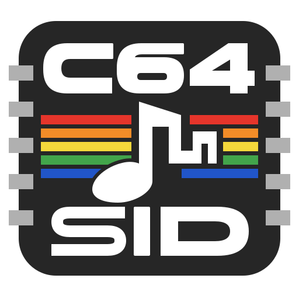

<p align="center">
  
</p>

# SID Song Crafter

A workbench for creative interpretations of existing musical scores on the **Commodore 64 SID chip**, supporting **single-SID and dual-SID stereo music**.

SID Song Crafter builds and uses a body of musical and technical knowledge to turn a given score into an inspiring SID performance. Creativity lies in choosing instruments, arranging the voices, shaping phrasing and applying effects or stereo to express the song's character. Making full use of the chip includes subtlety and restraint when the music calls for them. Original score composition is outside the current remit unless explicitly requested; see the [product purpose and scope](PRODUCTS.md).

Studies of SID composers, editors and drivers feed an executable library of instruments, arrangement techniques, examples and reusable tools, with listening evidence and limitations. Each new interpretation should apply and extend that knowledge so the next song benefits from what was learned. Original musical sources, common scores and SID arrangements remain separate so conversion does not erase source information or define the chip's expressive limits.

The working targets are PAL with one MOS6581/MOS8580 or two matching chips at `$D400/$D420`; native recipes default to MOS8580 and can select `sidModel: "MOS6581"`.

## Start here

- [Current interpretation queue](docs/research/study-plan.md#active-score-interpretation-trial): [The Pink Panther Theme audition](songs/pink-panther/README.md) applies researched character and tests reuse; the restrained Moon River first statement is accepted. Axel F remains later training material. [Night Transit](songs/night-transit/README.md) is closed as a rejected original composition.
- [Documentation](docs/README.md): setup, composition, audio, validation and architecture guides.
- [Tool boundaries](scripts/README.md): supported workflows and composition backends, source-specific study tools and compatibility exceptions.
- [Study plan](docs/research/study-plan.md#delivery-order-and-work-in-progress): finish one musical case through listening and reuse on different musical material before deepening the next; retained preparation covers Flashdance, six master-composer studies and four later pop/theme studies.
- [Technique lookup](docs/research/technique-index.md): reusable SID mechanisms, executable examples and structured evidence.
- [CPU timing lookup](docs/validation/cpu-timing.md) and [CIA tracing](docs/validation/cia-tracing.md): verified timing constraints and reusable validation tools.
- [Independent DRAX Für Elise comparison](songs/studies/drax-full-reconstruction/README.md): reconstructed recurring theme and its scope.
- [Cybernoid II independent title and finite ending](docs/research/composition/cybernoid-ii-preparation.md#independent-title-export-and-finite-ending): editable runtime programs, full-form verification and matched listening material; [familiar transfer](docs/research/composition/instruments/cybernoid-decoded-programs.md) separates instrument reuse from new composition.
- [Bach Toccata completed trial](docs/research/composition/bach-toccata.md#experiment-closure-and-reusable-outcome): complete mono accepted; Gyruss comparison and reusable musical lessons retained. The subtraction passage is preferred; further embellishment and stereo are deferred.
- [Native PAL/NTSC export portability](docs/research/study-plan.md#regional-export-verification-completed): verified composition/export contract.
- [Deflektor and bounded Trap contrast](docs/research/composition/daglish-contrast.md#scoped-corroboration-outcome): reconstruction, familiar transfer and scoped second-reference check complete.
- [Shades/Giana contrast](docs/research/composition/huelsbeck-contrast.md#isolated-pulse-motion-audition-and-reproduction): bounded PWM/shared-filter check complete; listener confirms original animation/tone difference.
- [Cybernoid II/Turbo Outrun contrast](docs/research/composition/tel-contrast.md): bounded sample-path/onset check complete; the listener heard no difference in the onset diagnostic.
- [Monty/Commando contrast](docs/research/composition/hubbard-contrast.md): bounded percussion and retained pulse-state checks verified; listener detects no difference in the opening diagnostic.
- [Take On Me](docs/research/composition/take-on-me-preparation.md): accepted independent reconstruction, authored ending and [familiar instrument transfer](docs/research/composition/instruments/take-on-me-decoded-programs.md); explicit 8580 target, original model metadata preserved as unknown.
- [Billie Jean](docs/research/composition/billie-jean-preparation.md#compiled-export-and-listening-package): accepted independent first-traversal reconstruction, authored ending and [familiar instrument transfer](docs/research/composition/instruments/billie-jean-decoded-programs.md).
- [Airwolf](docs/research/composition/airwolf-preparation.md#listening-verdicts-and-case-closure): phrase, corrected source continuation and [familiar transfer](docs/research/composition/instruments/airwolf-static-tones.md) accepted; reusable runtime and evidence retained. [Ghostbusters](docs/research/composition/ghostbusters-preparation.md#complete-native-title-and-listening-package) also has accepted opening speech, musical phrase, ending continuation and familiar transfer, backed by complete native CPU/VICE proof.
- [Audio-model calibration](docs/research/audio-assessment.md#trap-melodic-motion-and-development-calibration): Qwen matched the two Trap observations and both controls; Gemini failed development and silence. Models remain experimental supporting signals.
- [Ghouls independent player](docs/research/composition/ghouls-preparation.md#compiled-export-and-complete-listening-package): declared reconstruction and bounded Follin corroboration complete. The [familiar transfer](docs/research/composition/instruments/ghouls-decoded-programs.md) has accepted instruments, balance and ending, with a tentative tune reservation; all 53 tonal notes match the source, with common native tuning about 35 cents sharp.
- [Generate a listening package](docs/workflows/listening-package.md): one command for verified builds, cached rendering, A/B files and stage timings.
- [Monty independent title](docs/research/composition/monty-preparation.md): editable packed-score scheduling, shared pulse motion and state-dependent pitch; [familiar transfer](docs/research/composition/instruments/monty-decoded-programs.md) retains the same 53-note comparison phrase.
- [Contributor and agent guide](CLAUDE.md): development and research conventions; [AGENTS.md](AGENTS.md) links to the same file.

## Prepare local assets and check tools

```sh
python3 scripts/setup-project.py
python3 scripts/doctor.py
```

Setup downloads the pinned Elise/Flashdance references and the `c64-sid` hardware skill. Add `--include sid-music` only for bridge workflows; use `--offline` with existing caches/checkouts or `--check` for read-only hash verification. [Local setup](docs/setup/local-setup.md) explains prerequisites, optional selections and repairs. Doctor checks dependencies, renderer, VICE build configuration, ROM availability and asset hashes; it does not install tools or certify musical playback.

Local audio models, including SongBench/MuQ, are optional research tools. Normal setup, readiness checks, song builds and tests require no model weights or ML dependencies. Only follow [optional model setup](docs/setup/local-setup.md#optional-local-audio-models) for a deliberate evaluation trial; the [measured results](docs/research/audio-assessment.md#measured-local-songbench-trial) do not qualify SongBench as a dependable musical judge.

## Repository and dependencies

Project sources and research belong in Git. `.tools/` contains reproducible third-party checkouts; `.local/` contains diagnostics and runtime state; `build/` contains generated output. These directories and the machine-local `.codex/` configuration are ignored. The relative skill symlinks in `.agents/skills/` point to ignored, checksum-pinned local installs in `skills/`; only our own skill guide belongs in Git.

Original reference SID files must stay out of the public repository, including its Git history and LFS. [The asset registry](config/local-assets.json) retains source URLs and SHA-256 fingerprints; [setup](docs/setup/local-setup.md) downloads and verifies them on demand. Keep reference WAVs out of Git under ignored `.local/` or `build/`. Document exact reproduction commands, source hashes, subtune, renderer/version/settings, duration, gain, trim points and output hashes. Canonical analysis records live in [evidence](evidence/README.md), with compressed files in Git LFS and readable manifests in ordinary Git; prose indexes their detail. Follow [the cache workflow](docs/workflows/build-cache.md) for verification and restoration. Downloaded skill bodies continue to use the ignored `skills/<name>/` installation layout.

The checked-in [configuration example](config/codex.toml) records this machine's installation paths. Adapt it before activating it on another computer. Follow [local setup](docs/setup/local-setup.md) for exact upstream revisions and installation commands; use the upstream Bun lockfile for c64bridge.

## Native sound-design trials

After preparing the renderer and py65 dependency, build the pinned SID-Wizard exporter and run the original instrument bank:

```sh
python3 scripts/setup-sidwizard.py
python3 scripts/run-instrument-trials.py --output build/instrument-trials
```

Use a fresh output directory for a revised trial. The pipeline retains native SWM/SWI files, exports the actual Extra driver, audits its register writes, renders the phrases, and prepares amplitude-matched A/B audio. Start with the [candidate mix](build/instrument-trials/mix-candidate/mix-candidate.wav), then review the [individual comparisons and listening record](docs/workflows/instrument-trials.md). The user accepted the short mix as sounding OK; broader listening and hardware checks remain open.

To apply the palette to the complete Für Elise arrangement through the unmodified native Extra driver:

```sh
python3 scripts/native-song.py build songs/fuer-elise-sidwizard.json --output build/fuer-elise-native
```

This retains an editable SWM and instrument files alongside the SID, PRG, complete WAV, 20-second audition excerpt and conversion/verification reports. The [native recipe and timing record](docs/songs/fuer-elise-native.md) explain the section contrasts and a one-frame grace-note adjustment. The original source and baseline arrangement remain available for comparison; native editing need not pass back through the common score.

For two SIDs, run `python3 scripts/setup-sidwizard.py --sid-count 2`, then use a recipe with `sidCount: 2` and six ordered voices. The [native workflow](docs/workflows/native-song-workflow.md) includes an original six-voice/two-filter fixture and commands that verify its PSID, separate stereo channels and standalone PRG in headless VICE. This is a reusable technical foundation; a complete dual-SID song and its listening assessment remain separate work.

## Prepare the assembler

The song build uses Bun and only the assembler from the pinned c64bridge checkout. On a fresh checkout, prepare that dependency:

```sh
git clone https://github.com/chrisgleissner/c64bridge.git .tools/c64bridge
git -C .tools/c64bridge checkout 0781a7b6cfe7b92bbb6d68e048ad396bd3edfb18
(cd .tools/c64bridge && bun install --frozen-lockfile)
```

## Build and verify Für Elise

With the assembler, renderer, and headless VICE installed as described in [local setup](docs/setup/local-setup.md) and [the audio guide](docs/workflows/audio-workflow.md):

```sh
python3 scripts/song.py songs/fuer-elise.json
```

This produces `build/fuer-elise.{sid,prg,wav}` plus assembly, register traces, and verification evidence. The arrangement covers the complete source with both printed repeats, reduced explicitly to three SID voices. It lasts approximately 157 seconds including the release and verification tails. Add `--vice-audio` for an independent VICE/reSID recording at normal emulation speed.

The checked-in arrangement can be built without MIDI dependencies. To regenerate it from the preserved original after installing Mido as documented in [the score guide](docs/songs/fuer-elise-score.md):

```sh
PYTHONPATH=.tools/arrangement-deps python3 scripts/import-midi.py songs/sources/fuer-elise.mid songs/fuer-elise-import.json songs/sources/fuer-elise.score.json
python3 scripts/arrange-score.py songs/sources/fuer-elise.score.json songs/fuer-elise-arrangement.json songs/fuer-elise.json
```

The importer prints its information-loss report; the arranger prints its reduction report. Original MIDI and LilyPond sources remain unchanged. See [the workflow](docs/workflows/song-workflow.md) for the design boundaries and adapting the tools to another song; see [the player contract](docs/architecture/three-voice-player.md) for the currently supported SID subset.

## Opening excerpt and tests

The smaller original example remains useful for learning and independent pitch checks:

```sh
bun scripts/build-song.ts
bun test tests/music.test.ts tests/fuer-elise.test.ts
```

Edit [the score](songs/fuer-elise-opening.json) for pitches, durations, and instrument settings. The [assembly player](songs/player.asm) supplies callable SID initialization/play routines and the standalone C64 entry point. Output goes to `build/fuer-elise-opening.{prg,sid,asm,events.json}`. The excerpt contains the right-hand opening only; accompaniment and a second SID are outside this first example.

For independent CPU and audio checks, first follow dependency setup in [the song guide](docs/songs/first-song.md) and [the audio guide](docs/workflows/audio-workflow.md), then run:

```sh
PYTHONPATH=.tools/test-deps:.tools/arrangement-deps python3 -m unittest discover -s tests -p '*_test.py' -v
.local/bin/render-sid build/fuer-elise-opening.sid build/fuer-elise-opening.wav 3.2
```

The resulting WAV can be played without an emulator window. Rendering and checking a file is separate from verifying access to the host's audio output.

## Verification status

The full three-voice arrangement passes binary/header guards, independent 6502 register-write checks, rendered audio checks, and genuine headless VICE execution through BASIC and back. An independent native VICE/reSID recording also passes clipping and ending checks; see [full-song evidence](docs/validation/fuer-elise-validation.md). The complete [native SID-Wizard candidate](docs/songs/fuer-elise-native.md) also passes source-note, grace-pitch, ending, rendered-audio and headless VICE checkpoint checks. Its listening verdict remains open; the user's initial short-mix feedback is recorded separately. Binary-monitor socket binding is denied in this session, and host audio playback failed; no live MCP emulator connection or assistant listening is claimed.
